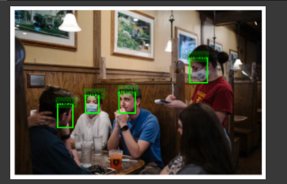

# Mask Detection

Detects faces in images and video and classifies each face as **with mask** or **without mask**. RetinaFace finds the faces; a fine-tuned Xception network classifies them. University project by Samet and Emre (2021).

## How it works

1. **Classifier training**: Xception pretrained on ImageNet (no top), followed by global pooling, a 1024-unit dense layer and a softmax output for 2 classes. Trained with Adam (learning rate 1e-4).
2. **Face detection**: RetinaFace locates every face in a frame.
3. **Classification**: each detected face is cropped and passed to the classifier; the frame is annotated with a box and label.
4. **Video**: frames are processed one by one and reassembled with FFmpeg (`output_sample1.mp4` is a sample result).

## Results

On a held-out test split of 1,616 images:

| Class | Precision | Recall | F1 |
|---|---|---|---|
| 0 | 1.00 | 0.99 | 1.00 |
| 1 | 0.99 | 1.00 | 1.00 |
| **Accuracy** | | | **1.00** |

Training accuracy reached 99.5% after the second epoch.

## Dataset

`Dataset/` holds about 16,000 images:

- `with_mask/`: 8,072 images (including augmented samples)
- `without_mask/`: 8,087 images

## Files

| File | Contents |
|---|---|
| `Project_Samet_Emre.ipynb` | Full pipeline: data loading, training, face detection, testing, video processing |
| `MASK_DETECTION_AND_RECOGNATION.pdf` | Project report |
| `Proje8.png` | Pipeline diagram |
| `output_sample1.mp4` | Annotated sample video |

## Run it

The notebook was written for Google Colab. Upload `Dataset/` to your Drive (or the Colab runtime), open the notebook in Colab with a GPU runtime and run the cells in order. Main libraries: TensorFlow/Keras, `retinaface`, OpenCV, scikit-learn, FFmpeg.
